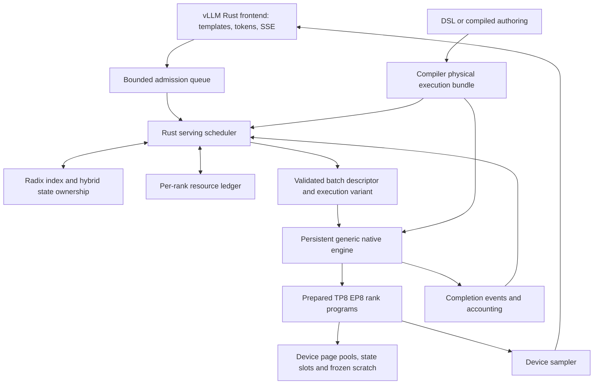

# Product serving execution and scheduling

Date: 2026-10-17. Status: proposed design and implementation sequence; no new serving capability is claimed by this document.

This is the next implementation plan for OpenPangu V2 92B, followed by independent 505B qualification. It supersedes the initial Qwen-first serving sequence in `design.md`, while preserving its frontend and device-residency constraints. The first release is a colocated single-node TP=8/EP=8 engine. Disaggregated prefill/decode is a later topology, not a prerequisite for useful serving.

## 1. Starting point and release boundary

| Area | Evidence today | Gap to close |
|---|---|---|
| HTTP frontend | Pinned vLLM 0.25.1 Rust frontend, native Qwen backend, streaming and sampling validation | Connect the generic executable 92B program to a persistent engine; remove model-specific capability naming |
| 92B execution | Full 46-layer TP8/EP8 device-resident decoder; prepared invocation and ACLGraph qualification | Persistent multi-request execution, packed token dimension, dynamic request state mappings |
| Scheduler | Qwen fixed lanes, continuous admission, one token per selected sequence per replay | Shared scheduler policy, real token-budgeted packed prefill, resource-aware admission |
| KV | Fixed capacity per request; C8 directly consumed by attention | Shared page pools, page-table indirection, ownership and event-safe reclamation |
| Prefill | Serial token calls | Multi-token causal attention and convolution with correct continuation state |
| Prefix cache | No native shared cache | Compressed token radix tree plus complete hybrid-state checkpoints |
| Performance | Short batch-one context-512 qualification: C8 graph TPOT 17.961 ms, approximately 31.35 GiB HBM/rank | Serving throughput, latency distributions, long-context correctness and memory-pressure qualification |

The current C8 format is per-128 latent scales with BF16 rotary, applied to the 16 DSL-selected DSA layers; 30 SWA layers use BF16. Paging must preserve these semantics. The existing causal candidate path is qualified at context 512, below index_topk=2048. Learned DSA selection and index-cache state are a separate correctness gate for longer contexts. Increasing allocator capacity does not qualify longer context.

Evidence: [batching](npu-continuous-batching.md), [frontend](vllm-frontend.md), [packed cache](packed-mla-cache.md), [workspace](shared-workspace-planning.md), [latest 92B measurements](validation/2026-10-17-shared-workspace/README.md).

## 2. Architecture and ownership

The compiler determines legal kernels, tensor layouts, casts, rank placement, collectives, state operations, shape envelopes and memory lifetimes. The online scheduler chooses requests, chunk sizes, page leases and an already-qualified variant. It cannot invent a cast, change cache precision, choose an undeclared EP algorithm or fall back to host execution.

Keep the vLLM Rust `GenerationBackend` boundary. Extract reusable policy into `inferfabric-scheduler`; the current `live.rs` mock PD scheduler is a test reference, not the native engine. Replace the fixed-lane orchestration in `frontend/src/native_worker.rs` through an engine adapter. Extract the generic program executor from the diagnostic executable into a persistent library entrypoint; retain the executable as a client of that same library for regression tests. Do not add a separate Pangu serving runtime.

Rust owns lifecycle, fairness, prefix metadata and logical resource ownership. C++ owns ACL handles, rank workers, prepared kernels, device allocations and completion events. Rust is built/cross-compiled locally; native build and NPU validation run in Docker. Model weights load once per worker group. No Python engine or subprocess per request.

## 3. Versioned serving-plan contract

Extend the existing executable bundle with a versioned serving manifest. The names below describe proposed fields, not existing DSL syntax.

| Manifest record | Required information |
|---|---|
| Compatibility | Program/checkpoint/backend fingerprints, ABI version, device/CANN/operator versions, tokenizer/template identity |
| Execution variants | `decode`, `prefill`, `extend`; token/sequence/context capacities, valid dtypes, graph capability, kernel IDs and measured costs |
| State components | Compiler ID, owning layers/ranks, dtype/layout, page size or slot shape, lifetime, append/read/clone/reset operations |
| Continuation semantics | Boundary position, required components, window-retention rule, checkpoint/restore support, indexer sharing dependencies |
| Resources | Weight, persistent, KV, state-checkpoint, metadata, sampler, communication, graph and scratch budgets per rank |
| Schedule | Ordered rank programs, collectives and sequence numbers, event dependencies, permitted buffer aliasing |
| Capabilities | Qualified context, batch/chunk ranges, sampling features, prefix support and unsupported request rejection |

The batch descriptor carries batch ID, engine epoch, request IDs and generation counters, packed token IDs, sequence offsets, absolute positions, prior lengths, query lengths, page-table handles, append slots, state-slot handles, sample-row selection and variant ID. For each sequence, `prior_length + query_length <= max_model_len`. Decode has query length one; extend has a positive chunk length. Tokens from separate sequences never share attention or convolution history. Table capacities, integer ranges and stale handles are checked before launch.

Expose engine operations equivalent to `prepare`, `reserve`, `submit_batch`, `poll_completion`, `cancel`, `retire` and `shutdown` through a versioned ABI. Submission returns an event/ticket; output buffers remain owned until acknowledgement. Requests transition through queued, admitted, prefill, decode, retiring and terminal states. Cancellation is logical immediately, physical reclamation waits for device completion. Host receives output tokens, requested output logprobs and small status records; no intermediate activations or state tensors.

## 4. Paged state management

Use preallocated per-rank pools separated by physical layout and state class. Logical page IDs map through stable device block tables to physical pages. Batch lanes are transient; request state survives lane changes. No compaction of captured storage addresses during service.

- C8 keeps 32-token pages with 656 bytes per token; BF16 starts with its qualified 16-token page layout. These are different pools, not a forced universal page size.
- Define a compiler-generated logical allocation group connecting required layer/rank resources. Physical IDs may differ by rank. Reserve every affected pool atomically before publishing a batch; failure rolls back all provisional leases.
- Each lease has a generation, references, component identity and last-use event. Track active-request references separately from prefix-cache references. Free only after both are zero and all referencing rank events complete.
- Shared sealed pages are immutable. A writable tail is private; branching uses explicit device-to-device copy-on-write. Every copy is a physical state operation visible in the viewer and trace.
- Sliding-window reuse follows declared absolute positions and retention intervals. Recycle only pages outside all active windows and cache references. The initial implementation may retain more pages conservatively; it must not claim sliding-window memory savings until qualified.
- Convolution/recurrent snapshots use bounded state pools, not KV-shaped fake pages. Pangu's two-token MoME history for each relevant projection is persistent; mHC residual streams are token activations, not cross-token state. Qwen recurrence uses its own typed component descriptor.
- DSA index cache, selected-index dependencies and cross-layer sharing must be declared when implemented. A cache format lacking a required component is ineligible for prefix restore.

Device attention consumes block tables and packed cache directly. Arbitrary physical page placement must work; a logical page allocator over a contiguous-only kernel is not sufficient. Qualify the vendor kernel's length/table update behavior under replay. If lengths are capture-time host attributes, implement a graph-safe device-metadata kernel/adapter or reject that variant; never silently replay stale metadata.

HBM accounting per rank:

`usable budget = utilization * device capacity - external use - safety reserve`

`serving demand = weights + fixed engine/graphs + scratch + communication + sampler + metadata + KV pools + state pools`

Avoid double-counting pool contents as per-request allocations. Report reserved, occupied, shared, evictable, pending-retirement and free bytes separately. The most constrained rank/pool determines admission. Startup discovery covers every allowed shape variant, then a fresh preparation reserves maximum shared workspace before arena binding. A measured maximum only covers those variants. New shapes require re-preparation, not live workspace growth.

Start with one compute stream per rank and serialized variants, so scratch can use a maximum rather than a sum. Any later overlap requires an explicit overlapping-lifetime plan and additional scratch. Graph objects, graph-private allocations and metadata buffers must also fit the configured envelope.

## 5. Real prefill and chunked extend

Implement a packed ragged token axis `T = sum(query_lengths)`. Projection, normalization, routing and FFN operate over T tokens; attention combines each request's cached prefix with its causal new-token segment. Padding is accounted separately. A full prompt must not execute the decoder T times.

For Pangu, lower batch-aware mHC, MoME convolution, Q/K/V transforms, rotary, cache append, dense FFN, MoE routing/expert dispatch and attention. Segmented convolution consumes the request's incoming history and writes exactly its outgoing history. Attention for position p reads no future token, even when the entire chunk is appended before the attention kernel. TP/EP collectives carry token dimensions; zero-token experts and routing imbalance require explicit capacity/overflow handling with no dropped routes.

Begin with homogeneous packed prefill and batched decode variants. Then support mixed logical batches using a single physical plan with explicit decode and extend sub-batches where kernels differ. Shared tokenwise operators may be fused later. Mixed scheduling does not require one attention kernel, but it must not conceal repeated single-token prefill.

Chunking partitions the same prompt into consecutive ranges. Only the final prompt row produces the first generated token; intermediate chunks do not sample. Restore/update convolution and attention state at each chunk boundary. Correctness must be invariant to chunk partitions, padding, lane placement and interleaving within declared numerical tolerance. For quantized cache, compare against the same precision path, not an unrelated BF16 contract.

Long-context work includes the actual learned DSA indexer, its weight bindings, full/shared-layer rules, index cache and sparse attention selection. Qualify positions below, at and above 2048 and SWA wrap boundaries. Context admission remains capped at the verified limit until that gate passes.

## 6. Continuous batching policy

`max_num_seqs` bounds resident active requests, not HTTP queue length. `max_num_batched_tokens` bounds real input tokens across all sub-batches in one scheduling iteration. Expose a separate bounded queue and queue deadline. Count cached tokens separately from newly computed tokens; expose padded token work too.

At each completed scheduling boundary:

1. Drain cancellation and completion records; retire safe resources and commit completed prefix checkpoints.
2. Choose ready decode requests using deficit/age fairness and reserve their next writes first. If the token budget is smaller than the active count, rotate fairly across iterations.
3. Allocate the remaining token/time budget to partial prefills and new admissions, with a configurable maximum prefill chunk and aging. Limit simultaneously partial prompts to prevent one workload from pinning all KV.
4. Check all-rank KV/state/route capacity, select a legal variant, and stage its descriptor. Publish only after reservation succeeds everywhere.
5. Execute the common batch sequence on all ranks; commit lengths and expose sampled outputs only for completed work.

Use calibrated variant costs to cap prefill work against a decode latency budget, not only a token count. Start with conservative deterministic limits; record prediction error before enabling adaptive policy. A bounded aging quota prevents endless decode arrivals from starving prefills. Never reorder operations within a request.

Initial admission reserves worst-case declared prompt plus generation state (window-aware where qualified) for each admitted request. This is conservative but ensures progress without offload. Later enable incremental reservations with decode headroom and explicit recompute preemption: discard a chosen request's device state after completion and requeue its retained token history. Expose recomputed tokens and latency; restore per-request sampling counters so recomputation does not consume new RNG draws. No host KV/activation offload.

A single rank leader determines the batch and collective order. Rank-local page IDs are distributed as metadata. All ranks execute the same collective sequence, including empty routes. Rank failure terminates the worker group and affected requests; do not reuse potentially divergent state or silently continue with fewer ranks.

## 7. Radix prefix cache with hybrid continuation state

Use a compressed token radix tree in Rust. SGLang provides the reference pattern: token-prefix lookup with component-specific state validity. Its [unified-cache design](https://github.com/sgl-project/sglang/blob/main/python/sglang/srt/mem_cache/unified_cache/components/README.md) separates logical tree management from physical cache components; see also its [hybrid cache explanation](https://www.sglang.io/blog/unified-radix-cache). We adopt that separation, not SGLang's Python runtime or host-cache tiers. References inspected 2026-10-17; upstream main is mutable.

Our proposed node contains an edge token span, parent/children, absolute boundary, compatibility namespace, component handles, readiness/completion epoch, active pins and eviction statistics. The tree contains host metadata only; KV and snapshots remain on device.

Namespace keys include checkpoint and executable semantic identities, cache dtype/scale/layout, positions/RoPE settings, adapter identity when supported, tokenizer/template identity, state schema, rank topology and tenant/cache-sharing domain. Compare token spans exactly after hash lookup. A hash collision must never yield a hit. Sampling settings do not change prefix activations; initialize request-local RNG and penalty counts from the full request independently.

A reusable boundary means **all** continuation components exist at the same position and are device-complete on every rank. Lookup returns the longest usable boundary, not simply the longest matching token edge. Full-attention prefixes need all required earlier pages; SWA needs the declared retained window; MoME needs its history snapshot; future DSA needs its index state. Metadata-only split points do not synthesize a historical recurrent snapshot. If a split lacks a complete checkpoint, back off and recompute from an earlier usable node.

First implementation publishes checkpoints at completed chunk boundaries aligned to the least common multiple of applicable page sizes (32 tokens for the current 16/32 layouts). Seal full pages; keep incomplete tails private. Copy small hybrid snapshots into budgeted device checkpoint slots using planned D2D operations. A requester pins the matched resources atomically and clones mutable state into private slots before extending. Concurrent duplicate insertions converge on one committed node; unselected resources retire safely after completion.

Do not cache sampled output as reusable next-token state. With a fully matched prompt and no retained logits, select a valid checkpoint strictly before the final prompt token and recompute the suffix to obtain the final logits. This also handles page-aligned prompts whose final checkpoint is otherwise a full hit. An optional future final-hidden/logit cache requires its own memory and semantic contract. Report only the tokens actually skipped as cached.

Eviction starts with unpinned complete checkpoint bundles using LRU; remove dependent descendants or mark them unusable where their required history disappears. Do not evict resources in flight. Bound metadata and snapshot counts as well as KV bytes. Later cost-aware retention may score saved prefill time per scarce byte, subject to starvation and tenant quotas. Cache sharing is scoped explicitly; default to isolated tenant namespaces and avoid exposing another tenant's prompt or cache trace.

## 8. ACLGraph, inspectability and production behavior

Compile a finite family of token/sequence/context envelopes. Prewarm and validate allowed variants before readiness; metadata updates use stable staging/device buffers and stream-local events. Initial service uses one outstanding compute batch per rank, simplifying state commit and frozen scratch reuse. No global device fences, allocation inside capture/replay, activation D2H, or unreported state copies. Unsupported shapes are rejected or split into declared legal chunks before submission.

The viewer gains a serving overview plus selectable decode/prefill/extend variants. Each shows token shapes, actual kernels, casts, TP/EP placement and algorithm, collective order, cache page formats, state transitions, graph buckets, scratch maximum and total HBM envelope. An optional runtime trace overlays batch ID, request spans, chunk cursor, prefix hit boundary, allocation/retirement, component copies, selected variant, measured latency and scheduling reason. Static plans and runtime observations must remain distinguishable. Token contents are redacted by default.

Production work also includes:

- Readiness only after checkpoint validation, all-rank preparation, resource profiling and warmup; health detects rank stalls and device errors.
- Consistent OpenAI response/stream usage, EOS/stop/min-token semantics, disconnect cancellation and bounded slow-consumer queues. Validate advertised sampling/logprob features; reject unsupported options explicitly.
- Per-request RNG indexed by generation position, device-side penalties/sampling, deterministic seeded behavior under rescheduling. Prefix restore must not restore another request's RNG.
- Admission limits, authentication integration, tenant quotas, prompt/output limits, queue timeouts and graceful drain. Do not log weights, secrets or prompt text by default.
- Structured metrics: TTFT including queue, prefill throughput, ITL/TPOT distributions, SLO goodput, padding, route imbalance, collective latency, prefix saved compute, per-pool pressure and cancellations.
- Watchdogs, rank-group restart, leak detection, checkpoint integrity, compatibility manifest and reproducible deployment. Failed in-flight generations return an error; transparent replay after already-streamed output is not promised.

## 9. Milestones and acceptance gates

Each milestone gets its own implementation commit, validation artifacts and push. Local policy/allocator/compiler tests run before NPU qualification; fake workers prove invariants only, never numerical correctness.

| ID | Deliverable and main code ownership | Exit gate |
|---|---|---|
| S0 | Serving/state manifest and ABI; compiler/IR plus scheduler interfaces; preserve existing generic execution | Manifest round trips, invalid state/layout/shape rejection, compatibility and lifecycle tests; unchanged full 92B fixtures |
| S1 | Persistent program engine and vLLM Rust adapter; runtime/native/frontend | Multiple sequential 92B HTTP/SSE requests load weights once; cancellation, shutdown and error propagation; unchanged batch-one output and graph residency audits |
| S2 | Per-rank pools, page tables, state slots and true multi-sequence decode; compiler/native/runtime | Random noncontiguous page placement, page boundaries, slot reuse, mixed lengths, stale-handle rejection, all-rank rollback; concurrent output equals isolated output |
| S3 | Packed prefill kernels and generic prefill physical plan; compiler/native | Multi-token projections/FFN and causal attention in trace; prompt logits/state versus serial oracle, ragged batching, MoME boundary tests and full 92B continuation |
| S4 | Chunked extend and continuous mixed scheduling; scheduler/frontend/native | All chunk partitions and interleavings agree; budget/fairness/cancel/slow-client tests; no decode starvation under sustained prefill or inverse starvation |
| S5 | Learned DSA/index-cache path and context qualification; DSL/compiler/native | Full-model output against pinned reference across index-topk and SWA boundaries; requested context advertised only after qualification |
| S6 | Radix cache and complete hybrid checkpoint reuse; scheduler/runtime/physical state ops | Cold/hit/partial/split/branch/eviction equivalence; full-hit logits case; multi-tenant isolation, quantized layouts, rank cancellation and constrained-memory stress |
| S7 | Production performance and failure qualification; benchmark/deployment/frontend | Long soak, no memory growth, overload bounded, rank crash/drain behavior; matched OmniInfer workload comparison with TTFT/ITL/goodput and resource reports |
| S8 | 505B and further topology qualification | Independent fit/topology/kernel checks and every S1-S7 gate on the exact checkpoint; no assumption that 92B TP8 layout transfers unchanged |

Dependency chain: S0 -> S1 -> S2 -> S3 -> S4. S5 extends S3/S4 context semantics. S6 contracts are designed in S0 and can first be tested within the qualified short-context envelope, but production long-context cache acceptance requires S5. S7 is instrumented from S1, with release gating after S6. No NPU occupation is needed to begin S0 and scheduler/ownership tests.

The first implementation slice should be **S0 plus S1**, followed by S2; do not build a prefix tree atop the current fixed per-request decoder buffers. Preserve the serial decoder as the numerical oracle until packed/chunked paths pass.

## 10. Validation and performance decision rules

Use exact greedy output fixtures where stable, plus per-layer/logit/state error tolerances declared before running tests when kernel reduction order changes. Run BF16 and C8 separately; stochastic tests verify seeded isolation and distributions. Compare new paths against the same checkpoint, precision and parallel semantics. Include prompts at 1, page-1/page/page+1, chunk boundaries, SWA boundaries, and the qualified context maximum. Long-context tests beyond 2048 require the learned indexer gate.

Benchmark cold and warm prefixes, unique and shared prompts, short/long input-output mixes, steady arrivals and bursts at multiple concurrency levels. Report p50/p95/p99 TTFT and ITL, throughput and goodput under explicit SLOs, queue delay, actual cache hit savings, HBM peak/steady state and graph replay coverage. Separate tokenizer, queue, scheduler, device and network time. The old 33-token measurement is a regression sample, not a capacity claim.

Target at least the matched OmniInfer setup's SLO goodput and tail latency using the same hardware, checkpoint, cache format, TP/EP methods, prompt distribution and offered load. Pin reference software and record configuration; numerical and device-residency gates cannot be traded away for speed. Absolute production SLOs are deployment inputs to set before the release benchmark, not invented from the current demo.

Fault tests cover exhaustion of each pool independently, in-flight cancellation, rank failure before/after launch, duplicated completion, stale epochs, prefix eviction while pinned, output backpressure and shutdown with active graphs. Verify all allocations return to the expected pool/cache baseline and captured addresses remain stable.

Follow-on work after these gates: optimized EP all-to-all/AGRS alternatives with explicit planner costs, multi-stream overlap with independently planned workspaces, cost-based chunk/bucket tuning, speculative execution, PD with complete device-state transport, and JIT specialization bounded by artifact validation and memory budgets. Host KV offload remains outside this design and cannot be introduced implicitly.
