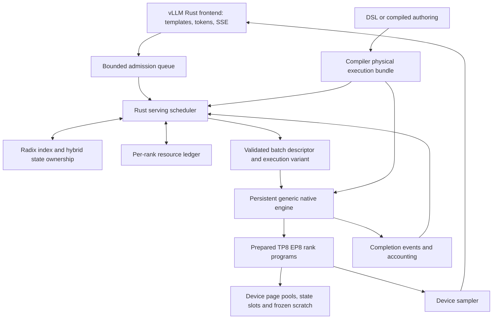

# Product serving execution and scheduling

## Current qualified baseline (2026-10-18)

Use the [planned bulk-domain candidate](validation/2026-10-18-bulk-domains/README.md)
as the current performance baseline; the observations below retain the history of
older failures and fixes. `IFTOKN09` assigns uncaptured bulk AllReduce to AI_CPU
and leaves decode graphs and AllGather on HOST. The assignment is encoded and
visible in the plan viewer. Full 92B native and vLLM Rust 0.25.1 HTTP output pass
through first EOS at 64K. A 65,520-token uncached prompt executes exactly fifteen
4096-token forwards and one 4080-token tail, without a prefill graph.

Observed mixed HTTP long TTFT is 11.70–11.75 seconds; short peers receive first
text in 739–763 ms and finish before the long request. Warm 61,440-token reuse
has TTFT 2.01–2.07 seconds. Four isolated native decode calls after long context
have median 22.67 ms; this is not a production latency percentile. Extra HCCL
resources add approximately 500–506 MB HBM per rank outside the unchanged frozen
activation arena. The new domain remains compilation opt-in.

Remaining foundation work is ordered by dependency:

1. Requalify repeated **64K**, not just 8K, mixed request churn with fixed output,
   cancellation, queue and host-resource gates. Keep the 128 MiB post-wave RSS
   growth bound and stable thread/FD requirements; passing a short run does not
   prove a long-duration soak.
2. Cover transport-level slow clients and bounded overload end to end. Internal
   bounded-channel tests do not prove socket backpressure behavior.
3. Qualify rank/backend failure, explicit unhealthy state, drain and restart,
   including page and prefix snapshot ownership. Never continue a damaged rank
   group through a hidden fallback.
4. Reduce mixed-request output gaps (currently 508–547 ms text-chunk intervals)
   while retaining the requested 4K prefill quantum and correct shared scheduling.
   Compare TTFT/ITL/goodput with matched OmniInfer conditions; isolated decode
   timings do not close this gate.

The first [24-wave 64K resource gate](validation/2026-10-18-bulk-domain-load/README.md)
completes all 120 reference load/recovery responses, but **fails** because wave
14 samples one additional FD (77 versus 76); final FD count returns to baseline.
RSS growth is 73.96 MiB, below 128 MiB, and threads remain stable. FD identity
instrumentation has been added without relaxing the gate. Resolve or explain
this observation before marking the repeated-load gate complete.

A local real-TCP regression now exercises the production HTTP connection loop
with a synthetic streaming body: a stalled client stops body polling within a
bounded deadline and byte envelope, a peer health request still completes,
reading resumes output polling, and disconnect drops the source before graceful
shutdown completes. Run `cargo test --manifest-path vendor/rust/Cargo.toml
-p vllm-server transport_backpressure_tests --lib` in local WSL. This passes,
but is transport-layer evidence only: full-model slow-client admission,
cancellation and memory-pressure qualification remains open. No production
listener behavior or timeout was changed to make the test pass.

[Completion-order qualification](validation/2026-10-18-completion-order/README.md)
now passes on the updated frontend: terminal success is sent only after native
resident release and active-request removal succeed. Injected release failures
produce errors in both schedulers. The full 24-wave 64K HTTP run passes 120
reference load/recovery outputs with 71.82 MiB RSS growth, stable threads/FDs and
complete page reclamation. This establishes a bounded repeated-load gate, not a
production soak or an explanation of the earlier isolated FD excursion. Prefix
restore on the updated frontend remains to be requalified.

Non-greedy 92B sampling, wider prefix-cache budgets, broader quality and sustained
production SLO evidence also remain release gates. Keep experimental long-context
and bulk-domain qualification explicit until those applicable gates are met.

## Execution priority and release gates (2026-10-18)

Work follows this dependency order. Finish the serving foundation before APC or
secondary optimizations; a component probe alone does not complete a gate.

1. **Bulk prefill and bounded memory:** execute the uncached suffix in eager,
   uncaptured chunks of up to 4,096 tokens, with actual tail lengths. No
   token-by-token prefill and no long-prefill graph capture. Qualify frozen
   workspace/arena coverage across supported chunk shapes and request reuse.
2. **Continuous batching through HTTP:** combine independent requests and mixed
   prefill/decode work within `max_num_seqs` and `max_num_batched_tokens`.
   Preserve decode graphs, device residency, exact output, cancellation safety
   and resident reuse. This depends on gate 1's memory contract.
3. **Long-context serving:** exercise multiple 4K chunks, then 8K/16K/32K/64K
   prompts with independent output references, concurrent short requests, TTFT,
   TPOT and memory measurements. A cold 65,536-token prompt requires 16 bulk
   forwards. Do not advertise 64K readiness from kernel-only tests.
4. **APC and production hardening:** qualify trie snapshots, arithmetic-history
   compatibility, eviction and isolation after the execution geometry is stable;
   then complete overload, backpressure and sustained-load release gates.

Current evidence: the [pooled arena contract](validation/2026-10-18-pooled-arena/README.md)
resolved the earlier HTTP reuse failures. [64K HTTP serving](validation/2026-10-18-device-zero-http64k/README.md)
now passes independent EOS-scoped output, mixed requests, cancellation and page
reclamation with 4096-token uncaptured chunks. Planned device zero reduced the
measured long-request TTFT range from roughly 98–100 seconds to 34–61 seconds;
the variance and mixed-load latency remain performance gaps.

[Prefix reuse through HTTP](validation/2026-10-18-prefix-http/README.md) passes
4K-prefix hits, different-suffix continuation, salt isolation and eviction with
two active residents plus one snapshot. Its arithmetic identity preserves
batch history compatibility rather than accepting snapshots from arbitrary
peer geometries. [64K warm-prefix restoration](validation/2026-10-18-prefix64-http/README.md)
now passes 61,440-token reuse, salt isolation and eviction: measured warm TTFT
was 2.97–3.68 seconds versus 31.9–33.9 seconds for cold requests in that run.
Remaining release gates include sustained load, transport backpressure, fault
recovery, wider cache budgets and model-quality coverage. Native program serving
still rejects unsupported non-greedy sampling; it must not silently claim the
capabilities of other native backends. The experimental long-context opt-in
remains until the release gates are met.

The [short repeated-load and overload gate](validation/2026-10-18-repeated-http-load/README.md)
passes 12 four-client waves, repeated disconnect/recovery and an explicit
503/Retry-After burst. Longer-duration RSS stability and slow HTTP socket
buffering remain unproven; this gate is not a production soak-test claim.

The subsequent [24-wave host-resource gate](validation/2026-10-18-host-resource-growth/README.md)
**fails**: process RSS grows by 754 MiB after the first wave, despite correct
EOS-scoped outputs and unchanged device-memory audits. Fix and requalify this
serving-foundation regression before secondary feature work. Thread and FD
counts remain stable; allocator retention versus execution metadata growth is
not yet established. Do not raise the RSS threshold to turn this into a pass.
The [host allocator diagnostic](validation/2026-10-18-host-allocator/README.md)
then observed allocated arena bytes tracking RSS growth, with nearly unchanged
free arena and mmap bytes. Its original probe affected shutdown, so it supplies
runtime allocation evidence only, not a completed qualification. The corrected
probe passes a signal-handling regression test; allocation-site attribution and
the serving fix remain open.
The subsequent [between-wave stack diagnostic](validation/2026-10-18-allocation-stacks/README.md)
drains normally and attributes most sampled retained bytes to CANN `BlockCache`,
with a smaller HCCL task-history contribution. The latter has bounded FIFO
retention. The [pool-client trace](validation/2026-10-18-pool-ownership/README.md)
then distinguished returned pool clients from retained libc backing blocks and
identified surviving empty descriptors inside the vendor attention/cache APIs.

The [owned API adapters](validation/2026-10-18-owned-opapi/README.md) fix those
paths without changing device kernels or attention output flags. Full 92B
discovery/fixed/frozen qualification passes; 24 HTTP waves produce 120 correct
EOS-scoped results and drain normally. RSS still grows 336.7 MiB, above the
unchanged 128 MiB gate, although the final nine waves add only 0.86 MiB. This
short plateau is insufficient to claim a long-term bound.
[Current-library 64K qualification](validation/2026-10-18-owned-opapi64k/README.md)
now passes native and HTTP output, mixed scheduling, cancellation and prefix
isolation/eviction. Observed mixed HTTP long TTFT is 29.75–30.78 seconds; warm
61,440-token prefix reuse is 2.99–3.86 seconds. Four pure single-sequence native
decode batches have median 23.39 ms; this is a small timing sample, not a serving
SLO. The existing arena and device-residency contract hold. Attribution and
bounding of remaining host retention remain the next foundation gate.

Host metadata lifetime is part of gate 1's resource contract. A follow-up must
distinguish permanent weight/state/graph descriptors from descriptors belonging
to an uncaptured forward. The latter must cover its output sampling and
consensus work through the existing owning-stream completion; a lexical scope
ending when `execute_token` returns is too short. Destroy dependent invocations
before their descriptors, and retain explicit owners for tensors that escape
into persistent state or weight-layout caches. Audit ordinary and strided
descriptors separately, including live/peak transient counts and retained
entries. Do not clear raw-pointer caches indiscriminately: both `DeviceTensor`
and `PreparedWeightViews` retain pointers into them.

The [completion-scoped metadata implementation](validation/2026-10-18-metadata-leases/README.md)
now uses explicit descriptor leases in tensor values, transient caches covering
the full output-completion epoch, and permanent immutable-weight keys. Its small
lifetime tests and full 92B discovery/fixed/frozen output gates pass without
changing the device arena or adding fences. All ranks finish with zero live
transient descriptors/invocations. The 24-wave HTTP resource gate now passes: 120 correct load/recovery outputs, 24.16 MiB post-wave RSS growth against the unchanged 128 MiB limit, stable threads/FDs and complete shared-page reclamation. This closes the measured RSS regression; longer-duration production stability remains unproven. [64K HTTP qualification on this revision](validation/2026-10-18-metadata64k/README.md) now passes bulk prefill, mixed scheduling, cancellation and prefix reuse with the same arena. Mixed long TTFT is 26.69–31.77 seconds; warm 61,440-token prefix TTFT is 2.94–3.29 seconds. Short peers progress, but subsequent text chunks are spaced 1.38–2.00 seconds apart during competing 4K prefill. Reducing this mixed-workload delay remains a serving performance gate; idle TPOT is insufficient evidence. Preserve the requested 4K uncaptured quantum while addressing its execution cost.

Validation proceeds from focused shape/lifetime checks to a short full-model
HTTP regression, then longer-context qualification. Re-run costly full-model
tests only after a concrete fix or new release gate warrants them.

## Earlier implementation records (historical)

The records below describe the staged implementation and its limits at each
milestone. Use the current evidence above for present qualification status.

Earlier evidence: [shared-page ownership in native HTTP serving](validation/2026-10-17-shared-pages/README.md),
[native four-token packed prefill](validation/2026-10-17-packed-prefill/README.md)
and [Rust HTTP chunk scheduling](validation/2026-10-17-packed-http/README.md).
The frozen TP8/EP8 path passes full output fixtures and chunk/page-boundary
continuations through the existing 512-token envelope. HTTP chunk scheduling
charges actual input tokens to the budget and preserves independent resident
progress. Shared pages are reserved per request across all ranks and reclaimed
after completion; pool size is still the compiled resident-count times capacity.
SWA recycling, prefix snapshots and the 64K release gates below remain open.

[Planned page-table capacities](validation/2026-10-17-planned-page-tables/README.md)
now replace the fixed binding-count ceiling. C8 table allocation and its physical
recipe follow compiled capacity; oversized bindings fail before worker dispatch.
Metadata/ownership tests cover 65,536 tokens and the full 512-token native/HTTP
regression passes. This does not raise the serving context gate: BF16 SWA storage
still needs window recycling and longer-context decoder qualification.

The [SWA ring operator qualification](validation/2026-10-17-sliding-window/README.md)
now verifies absolute-position repeated-page tables through position 65,535,
including 120 exact ACLGraph replays. It establishes the following integration
contract; it does not yet enable recycling in the serving executor:

- Derive each cache's window from its attention consumer, rejecting incompatible
  consumers. Record window, page size, physical retention and absolute table
  length in the physical plan and serving manifest.
- Reserve enough unique owned pages for the union of all windows in a prewritten
  chunk. A 512-token window and four-token chunk require 34 16-token pages at
  arbitrary alignment. Preserve the smaller full-context allocation when the
  compiled context does not reach a wrap.
- Keep the ownership binding unique. Expand it into an absolute device table by
  mapping logical page `i` to owned page `i % ring_pages`; repeated table entries
  must not be mistaken for independently owned pool pages.
- Scatter through that mapping; keep RoPE and sequence lengths absolute. Use
  the declared window minus one for both attention and metadata `pre_tokens`,
  rather than deriving it from maximum model context. Metadata reuse must be
  keyed by compatible window contracts.
- Select/reset/release resident ownership without changing graph pointers.
  Prefix snapshots must own or copy their retained ring state before subsequent
  writes reuse its pages. Qualify actual scatter, shared ownership and full-model
  wrap output before raising the context gate.

The [explicit-window metadata implementation](validation/2026-10-17-window-metadata/README.md)
now passes the full standard 92B native/HTTP regression. Dense attention and its
metadata producer use the DSL window, with separate persistent buffers and
validated dependencies per window. The [explicit retention contract](validation/2026-10-17-retention-contract/README.md)
now distinguishes executable context from physical retained capacity in the generic
pool, with synthetic 64K ownership tests and a full native HTTP regression.
The [native ring integration](validation/2026-10-17-native-ring/README.md) now
emits BF16 retention policies, allocates retained storage, expands ownership into
absolute tables and scatters through the ring mapping. Production-state NPU tests
cover 65,536 addresses and 524 scatter graph replays; the full standard 92B native
and HTTP regressions pass. At the still-enforced context 512 gate the model does
not wrap, so full-model wrap output and longer-context qualification remain open.

The first [full-model SWA-wrap experiment](validation/2026-10-17-swa-wrap/README.md)
now matches all 72 independent-reference output tokens at prompt lengths 529,
1,024 and 2,040 across three repetitions. Mean TTFT is 4.99/9.63/19.30 seconds;
TPOT is 19.78–19.97 ms. This validates these retrieval cases, not general 2K or 64K
serving. Compilation can represent up to 65,536 tokens on implemented cache paths;
native admission above 512 requires the explicit experimental qualification opt-in.
The [full-model selection experiment](validation/2026-10-17-long-index-selection/README.md)
now covers 2,049, 3,072 and 4,088 prompt tokens: all match through EOS, but the
4,088-token forced continuation differs after EOS. Its full-token qualification
therefore fails. TTFT reaches 38.66 seconds and TPOT 20.13 ms at 4,088; all eight
rank residency/arena audits pass. A 16-token chunk experiment also diverges after
EOS and remains unpromoted. The independent quantized indexer now passes 2/4/16
query-row causal/top-k checks through 65,536 keys, including graph replay.
The [batched index-query implementation](validation/2026-10-17-batched-index-selection/README.md)
now uses one call and no output assembly copies per quantized chunk, exposed in
the physical recipe/viewer. All 99 standard tokens pass; all 72 long native
tokens remain unchanged, including the known reference divergence. Measured
TTFT improves 1.48–1.67%, with no arena/workspace growth. Next qualify larger
prefill chunks against a matching-budget reference, batch remaining attention
work, then advance diverse 8K/16K/32K/64K and concurrent HTTP tests while preserving
unresolved accuracy evidence. No admission gate changes.

The [sixteen-token experiment](validation/2026-10-17-prefill16/README.md) measures
32.5–32.8% lower isolated long-prompt TTFT than four-token chunks, with unchanged
long native tokens. Its matched-budget reference still exposes post-EOS
differences at 529 and 3,072 tokens; it remains unqualified. A concurrent 4,088-token
HTTP case passes full output, cancellation/reuse and zero final page occupancy,
but the peer short request sees 1.51-second TTFT and about 121 ms between streamed
text chunks. A single larger chunk is therefore insufficient: implement faster
batched attention plus multiple compiled prefill sizes, with a measured latency
budget deciding which variant is legal alongside active decodes. Include every
variant in maximum-workspace discovery and frozen arena binding.

[Batched packed-C8 attention](validation/2026-10-17-batched-attention/README.md)
now executes one call and no output assembly copies per chunk. The independent
operator oracle covers 1/4/16 query rows and graph replay; the full four-token
92B variant preserves all 99 standard and 72 previous long native outputs.
Measured four-token TTFT improves another 8.25–8.83% without workspace growth or
activation transfers. The known reference difference remains.
[Batched BF16 window attention](validation/2026-10-17-batched-window/README.md)
now also uses one call and one metadata buffer per window for the chunk. Full
standard output and all previous long native tokens remain unchanged; measured
four-token TTFT improves another 12.56–12.76%. The increased workspace is planned
before binding and all residency/arena audits pass. Larger full-model chunks,
per-query recurrent/projection work and latency-budget scheduling remain open.

The [updated sixteen-token qualification](validation/2026-10-17-window16/README.md)
passes all 123 short/529-token preparation and frozen outputs. Its 4,088-token
TTFT improves to 15.74 seconds and TPOT is 20.06 ms. The previous 3,072-token
post-EOS difference remains, so the long fixture still fails. Concurrent 4K HTTP
passes its unchanged reference; short-peer TTFT improves to 1.08 seconds but is
still delayed by fixed-size chunks. All rank resource/residency audits pass.

The [8K positional retrieval experiment](validation/2026-10-17-retrieval8/README.md)
now retrieves all early/middle/late answers correctly across nine full-model
requests at 8,176 input plus sixteen output tokens. All outputs match through
EOS, but middle/late forced continuations differ after EOS; full parity still
fails. TTFT is 31.59–31.73 seconds and TPOT 20.22–20.28 ms, with unchanged planned
workspace and all eight frozen/residency audits passing. This is experimental
coverage, not a production context-limit increase.

[Batched BF16 rotary](validation/2026-10-17-batched-rotary/README.md) now removes
per-query rotary invocations and output assembly. All 123 preparation/frozen
tokens pass and all 72 previous long native outputs are unchanged. The operator
is bit-exact across all supported chunk sizes and graph replay. Sixteen-token
4K TTFT improves another 9.52%, to 14.24 seconds, with unchanged arena/workspace;
HTTP/residency checks pass. Existing post-EOS reference differences remain open.

The [16K positional experiment](validation/2026-10-17-retrieval16/README.md)
retrieves all nine early/middle/late answers correctly and matches through EOS.
Forced continuation parity fails after EOS in every case. Baseline TTFT is
63.44–63.57 seconds and TPOT 20.27–20.29 ms; planned workspace remains unchanged
and all eight frozen/residency audits pass. The larger-context short regression
also exposes a preserved post-EOS difference. These results do not raise the
production admission limit or establish concurrent 16K serving readiness.

[Typed admission overload](validation/2026-10-17-overload/README.md) now returns
retryable HTTP 503 with distinct queue-full/backend-unavailable codes through
the vLLM Rust completion/chat submission paths. A real sixteen-request NPU burst
accepts eight queued streams and rejects eight with the expected retry metadata;
disconnect recovery returns correct output and final page occupancy is zero.
All 305 upstream server and 17 frontend tests pass. This closes the basic overload
response gap; sustained pressure, slow-client and rank-failure soaks remain open.

### Prepared prefill variant family

Version 6 adds an explicit list of legal query counts with
`--prefill-variants 2,4,8,16`. The existing `prefill_tokens` field remains the
maximum storage bound, not permission to invoke arbitrary smaller shapes.
Old bundles retain their exact-shape behavior. Each variant
needs its own numerical-class identity, tensor shapes, kernel recipes and cost
record in the physical plan/viewer; do not advertise an unprepared shape.

One engine must share weights, resident state and workspace across the family.
Use separate graph handles, retained outputs and custom-kernel lifetimes per
shape, with stable addresses. Discovery must exercise every shape and its output
invocation before computing the maximum shared workspace. Repeat that complete
preparation order before frozen-arena binding; account for all retained graph
outputs. Startup must fail if any declared variant lacks prepared storage or
exceeds the plan. A new shape must never trigger live capture/allocation fallback.

Expose the exact supported counts through the native ABI and validate them
against the manifest in Rust. Choose only legal counts fitting the remaining
prompt, round token budget and context. For an isolated prefill, choose the
largest qualified variant. With pending decode work, use measured upper-tail
invocation latency to bound decode delay, choosing a smaller prepared variant
when needed. Account for each admitted invocation's actual input tokens. A
latency bound smaller than every available invocation must be reported as
unachievable, not presented as a hard guarantee. Serial decode remains explicit
until multi-sequence kernels are implemented.

Qualification must alternate shapes on the same residents, exercise nonaligned
page/window boundaries, cancel and reuse slots, and check independent outputs
at the selected chunk boundaries. Preserve shape-dependent numerical differences
as failures. Measure isolated TTFT separately from mixed-workload TTFT and
per-token decode latency; streamed text chunks are not necessarily single tokens.
The compiler, native engine and Rust scheduler now implement this finite family.
Startup prepares and seals every declared graph; the ABI verifies the exact mask
against the serving manifest. Recipes retain maximum-sized storage and expose
each invocation's shapes, API repetitions and assembly copies in the viewer.
The scheduler currently chooses the largest declared shape fitting prompt and
token budget. Measured latency-aware selection remains open; this implementation
does not claim a decode-latency guarantee or multi-sequence packed kernels.
See [full-model qualification](validation/2026-10-17-prefill-family/README.md).

### Reproducible 64K retrieval ladder

For long HTTP qualification, `--request-timeout-seconds 900` raises the client
socket inactivity timeout; it is not a whole-run deadline or a serving latency
guarantee. Default tests still force all reference output tokens. The explicit
`--respect-eos` mode instead exercises normal serving through first EOS while
retaining the original reference and generation budget. Its report records
`through_first_eos`, sets `full_fixture_text` false, and pins both fixture hashes.
It must not be used to erase the separate forced-continuation mismatch evidence.
Both modes reject placeholder references and independently check declared
retrieval answers before starting the server. Local tests cover EOS truncation,
usage count including EOS, unchanged source data, no-EOS outputs and invalid
references. [Full NPU HTTP verification](validation/2026-10-17-continuation-ownership/README.md)
passes at 4K with normal EOS stopping; 64K HTTP qualification remains open.

The offline reference launcher loads both Omni custom-op vendor environments
itself. A 64K startup attempt without them failed on a missing mHC PreV2 symbol;
loading them explicitly allowed the engine to initialize and begin generation.
That failed attempt is an environment failure, not evidence of a 64K model limit.

`scripts/make-long-context-cases.py` produces deterministic early/middle/late
retrieval inputs at 8,192, 16,384, 32,768 and 65,536 **total** tokens, reserving
16 tokens for generation by default. Each case records its exact needle token
span and expected textual answer. Answers vary across cases. Record the emitted
tokenizer/input hashes with the reference configuration. For example, inside the
reference container:

```sh
python3 scripts/make-long-context-cases.py --tokenizer /models/92B/tokenizer.json \
  --output retrieval-8k-input.json --contexts 8192
bash scripts/reference-openpangu-decoder.sh --cases retrieval-8k-input.json \
  --output retrieval-8k-reference.json --max-model-len 8192 \
  --max-num-batched-tokens 16 --kv-cache-dtype int8_ds_mla
```

Generated `output_ids` are length placeholders, not expected tokens. The native
qualifier/comparator reject marked placeholders; the offline reference preserves
the case metadata and marks its generated outputs as non-placeholder. Check
reference answer correctness as well as native/reference token parity. A shared
wrong answer does not pass retrieval qualification. This suite is a baseline,
not a substitute for diverse reasoning, boundary numerical tests, concurrent
serving and pressure/cancellation soaks. Advance each context level only with
its own full-model results; operator-level 64K coverage does not qualify serving.
Use `scripts/compare-program-reference.py --tokenizer /models/92B/tokenizer.json`
with these fixtures. It requires the tokenizer, decodes only through the first
EOS, and checks the expected answer for the reference and every native repetition.
It still reports all forced output tokens and fails on post-EOS differences.
For long native suites, set `qualify-program-engine.py --timeout-seconds` to an
explicit run budget (default 1,800 seconds). Token and stderr files are written
during execution and retained on failure/timeout; `process.json` records the
process outcome. A completed process is not a qualification pass: output and
resource checks must still succeed before `results.json` is written.

Experimental learned-index execution now includes explicit INT8 index queries/keys
and FP16 scales/head weights in the [physical plan](learned-index-quantization.md).
Its [C8 reference boundary comparison](validation/2026-10-17-learned-index-int8/README.md)
matches 9/14 sequences, improving on the previous BF16 indexer's 8/14. Five
divergences remain; this is not qualified C8 parity or permission to raise the
serving context limit. The next numerical investigation must compare intermediate
values/logits against the pinned reference and isolate those differences.
The [output-parity investigation](validation/2026-10-17-output-parity/README.md)
reproduces the divergences with identical forced prefixes and finds that changing
reference prefill budget alone changes 6/14 reference sequences. Native matches
10/14 one-token-reference sequences. Align prefill shapes for subsequent operator
comparisons; neither reference is silently substituted for the other.
An explicit [BF16 MLA query rotary variant](validation/2026-10-17-query-rotary-bf16/README.md)
now aligns that precision boundary and removes 46 casts. It passes standard
fixtures but leaves all boundary output sequences unchanged; collective precision
was then [tested separately](validation/2026-10-17-collective-parity/README.md).
BF16 collectives passed the standard native/HTTP fixtures but matched only 9/14
one-token reference sequences, versus 10/14 with FP32. The selected experimental
DSL therefore retains FP32 collectives; the unpromoted variant and failures are
preserved. Resolve numerical differences using operator-boundary evidence while
advancing independent long-context state planning; no 64K admission change is
justified by these short-context experiments.

Date: 2026-10-17. Status: implementation in progress; qualified capabilities and remaining release gates are distinguished below.

This is the next implementation plan for OpenPangu V2 92B, followed by independent 505B qualification. It supersedes the initial Qwen-first serving sequence in `design.md`, while preserving its frontend and device-residency constraints. The first release is a colocated single-node TP=8/EP=8 engine. Disaggregated prefill/decode is a later topology, not a prerequisite for useful serving.

## 1. Starting point and release boundary

| Area | Evidence today | Gap to close |
|---|---|---|
| HTTP frontend | Pinned vLLM 0.25.1 Rust frontend serving the generic 92B executable; streaming, concurrent requests, cancellation and retryable queue-overload responses qualified | Stochastic 92B sampling, sustained overload and failure/slow-client soak |
| 92B execution | Full 46-layer TP8/EP8 device-resident decoder; persistent resident states, prepared invocations and ACLGraph | Multi-request batched decode and longer-context model qualification |
| Scheduler | Continuous admission; actual token-budgeted four-token prefill chunks and serial decode, rotating resident progress | Larger efficient chunks, batched kernels and pressure-aware admission |
| KV | Shared physical page ownership, partial page tables, all-rank reservation and completion-safe reclamation; packed C8 consumption | Configurable pool budget, long-context tables, learned index cache, SWA recycling and prefix sharing |
| Prefill | Four-token packed projection/FFN path with explicit per-query causal attention and convolution; boundary outputs qualified | Larger chunks, efficient attention batching and long-context reference qualification |
| Prefix cache | No native shared cache | Compressed token radix tree plus complete hybrid-state checkpoints |
| Performance | Short batch-one context-512 qualification: C8 graph TPOT 17.961 ms, approximately 31.35 GiB HBM/rank | Serving throughput, latency distributions, long-context correctness and memory-pressure qualification |

The current C8 format is per-128 latent scales with BF16 rotary, applied to the 16 DSL-selected DSA layers; 30 SWA layers use BF16. Paging must preserve these semantics. The existing causal candidate path is qualified at context 512, below index_topk=2048. Learned DSA selection and index-cache state are a separate correctness gate for longer contexts. Increasing allocator capacity does not qualify longer context.

### Required release target: 64K context

The opt-in HTTP prefix-cache integration now passes the
[2K–4K native gate](validation/2026-10-17-prefix-http/README.md). Configure both
`--prefix-cache-slots` and `--prefix-cache-namespace`, with explicit
`--max-num-seqs`; active and snapshot residents must fit the compiled capacity.
Cache salts isolate request domains. The compiler publishes supported state-copy
layouts, and startup rejects incomplete capability sets. The worker publishes
only completed, aligned continuation state and restores only exact token and
arithmetic histories; all payload copies remain on device. One last eligible
checkpoint per request limits publication cost. Longer-context and concurrent
cache qualification remain separate gates.

The native 65,520-input plus 16-output retrieval run now completes at TP=8/EP=8
with bounded frozen arenas and no activation host transfers. Early, middle and
late retrieval answers match through EOS; forced post-EOS continuations still
differ from the independent reference. Cold TTFT is approximately 235 seconds,
with decode TPOT approximately 20.7 ms. This is evidence of executable capacity,
not production readiness; see [the preserved 64K results](validation/2026-10-17-retrieval64/README.md).
The HTTP concurrency, prefix restoration, pressure and soak gates below remain
mandatory before advertising a 65,536-token serving envelope.

The INT8/FP16 sparse-indexer vendor boundary now passes independent causal
selection checks through 65,536 keys and 24 ACLGraph replays; see the
[kernel qualification](validation/2026-10-17-quant-sparse-indexer/README.md).
This closes only that kernel-interface gate. Decoder integration, reference
parity and the serving gates below remain required.

The user explicitly requires robust **65,536-token total context** for 92B.
`max_model_len` includes prompt plus generated tokens; a 64K benchmark reserves
output headroom rather than accepting 65,536 prompt tokens plus extra generation.
This is a release requirement, not a currently advertised capability. Keep the
admission limit at the qualified envelope until every relevant gate below passes.

The HTTP qualification must exercise **every** supplied positional reference,
not select just the longest prompt (early/middle/late cases can have equal
lengths). Each long case runs alongside a cancelled short stream and a fresh
short request; the short request must finish before the long one, both completed
outputs must match the independent reference, and all three usage counts must
match without prompt truncation. `qualify-program-http.py --resident-cases`
records each case in `mixed_resident_cases`; `mixed-progress.json` preserves
partial evidence after failures and is never a passing qualification. This gate
does not replace simultaneous long-request pressure, prefix restoration, or
failure/soak testing. Normal-EOS checks must retain the separate full-forced-output
failures and explicitly report their narrower comparison scope.

- **S2:** size page tables from the compiled context and pool budget, removing the
  fixed 32-entry table assumption. Keep absolute positions distinct from physical
  cache rows. Recycle SWA pages only after their window, borrowers and device events
  permit it. Page/slot capacity must cover every rank before admitting a request.
- **S3/S4:** real packed, chunked prefill with bounded workspace and scheduler token
  budgets. Avoid allocating a context-squared 64K attention mask. Preserve causal
  attention, MoME history, rotary positions and state transitions across arbitrary
  legal chunk boundaries. Long prompts must not indefinitely stall active decodes.
- **S5:** implement learned DSA index projections, index-cache layout, layer sharing
  rules and top-k selection from the checkpoint architecture. The current exact
  causal-candidate shortcut is invalid above its declared range. Validate logits
  and continuation against a pinned reference at 2K boundaries and 4K, 8K, 16K,
  32K and 64K total lengths, with early/middle/late retrieval probes and repeated
  SWA wraps. Matching two layouts of our own executor is insufficient evidence.
- **S6:** prefix restore at long boundaries includes the complete MoME/index/SWA
  continuation state. Test shared prefixes, divergent branches, full-hit logit
  recomputation, eviction and cancellation without premature reuse or host offload.
- **S7:** measure cold/warm-prefix TTFT, TPOT/ITL distributions, throughput, queue
  delay and peak/steady HBM across those lengths and mixed short/long concurrent
  workloads. Compare the same checkpoint, cache dtype and TP/EP settings against
  OmniInfer. Exercise constrained pools, full admission queues, slow/disconnected
  clients, rank failure, repeated request churn and graceful shutdown; require
  bounded memory and no stale state leakage. Record actual supported concurrency
  at 64K from the tightest rank's measured memory budget, not a guessed constant.

At the current cache formats, the 16 full-history C8 layers alone require
687,865,856 bytes per rank for one 65,536-token history. Thirty retained 512-token
BF16 windows add 17,694,720 bytes before page slack. These are payload estimates,
not a fit claim: learned index state, recurrent/prefix snapshots, graph storage,
metadata, weights, routing and scratch must also be planned and measured. Reserve
the maximum shared workspace before arena binding for every qualified batch/chunk
variant. Larger lengths or new variants require requalification, never implicit
fallback or live scratch growth.

Evidence: [batching](npu-continuous-batching.md), [frontend](vllm-frontend.md), [packed cache](packed-mla-cache.md), [workspace](shared-workspace-planning.md), [latest 92B measurements](validation/2026-10-17-shared-workspace/README.md).

## 2. Architecture and ownership



The compiler determines legal kernels, tensor layouts, casts, rank placement, collectives, state operations, shape envelopes and memory lifetimes. The online scheduler chooses requests, chunk sizes, page leases and an already-qualified variant. It cannot invent a cast, change cache precision, choose an undeclared EP algorithm or fall back to host execution.

Keep the vLLM Rust `GenerationBackend` boundary. Extract reusable policy into `inferfabric-scheduler`; the current `live.rs` mock PD scheduler is a test reference, not the native engine. Replace the fixed-lane orchestration in `frontend/src/native_worker.rs` through an engine adapter. Extract the generic program executor from the diagnostic executable into a persistent library entrypoint; retain the executable as a client of that same library for regression tests. Do not add a separate Pangu serving runtime.

Rust owns lifecycle, fairness, prefix metadata and logical resource ownership. C++ owns ACL handles, rank workers, prepared kernels, device allocations and completion events. Rust is built/cross-compiled locally; native build and NPU validation run in Docker. Model weights load once per worker group. No Python engine or subprocess per request.

## 3. Versioned serving-plan contract

Extend the existing executable bundle with a versioned serving manifest. The names below describe proposed fields, not existing DSL syntax.

| Manifest record | Required information |
|---|---|
| Compatibility | Program/checkpoint/backend fingerprints, ABI version, device/CANN/operator versions, tokenizer/template identity |
| Execution variants | `decode`, `prefill`, `extend`; token/sequence/context capacities, valid dtypes, graph capability, kernel IDs and measured costs |
| State components | Compiler ID, owning layers/ranks, dtype/layout, page size or slot shape, lifetime, append/read/clone/reset operations |
| Continuation semantics | Boundary position, required components, window-retention rule, checkpoint/restore support, indexer sharing dependencies |
| Resources | Weight, persistent, KV, state-checkpoint, metadata, sampler, communication, graph and scratch budgets per rank |
| Schedule | Ordered rank programs, collectives and sequence numbers, event dependencies, permitted buffer aliasing |
| Capabilities | Qualified context, batch/chunk ranges, sampling features, prefix support and unsupported request rejection |

The batch descriptor carries batch ID, engine epoch, request IDs and generation counters, packed token IDs, sequence offsets, absolute positions, prior lengths, query lengths, page-table handles, append slots, state-slot handles, sample-row selection and variant ID. For each sequence, `prior_length + query_length <= max_model_len`. Decode has query length one; extend has a positive chunk length. Tokens from separate sequences never share attention or convolution history. Table capacities, integer ranges and stale handles are checked before launch.

Expose engine operations equivalent to `prepare`, `reserve`, `submit_batch`, `poll_completion`, `cancel`, `retire` and `shutdown` through a versioned ABI. Submission returns an event/ticket; output buffers remain owned until acknowledgement. Requests transition through queued, admitted, prefill, decode, retiring and terminal states. Cancellation is logical immediately, physical reclamation waits for device completion. Host receives output tokens, requested output logprobs and small status records; no intermediate activations or state tensors.

## 4. Paged state management

Use preallocated per-rank pools separated by physical layout and state class. Logical page IDs map through stable device block tables to physical pages. Batch lanes are transient; request state survives lane changes. No compaction of captured storage addresses during service.

- C8 keeps 32-token pages with 656 bytes per token; BF16 starts with its qualified 16-token page layout. These are different pools, not a forced universal page size.
- Define a compiler-generated logical allocation group connecting required layer/rank resources. Physical IDs may differ by rank. Reserve every affected pool atomically before publishing a batch; failure rolls back all provisional leases.
- Each lease has a generation, references, component identity and last-use event. Track active-request references separately from prefix-cache references. Free only after both are zero and all referencing rank events complete.
- Shared sealed pages are immutable. A writable tail is private; branching uses explicit device-to-device copy-on-write. Every copy is a physical state operation visible in the viewer and trace.
- Sliding-window reuse follows declared absolute positions and retention intervals. Recycle only pages outside all active windows and cache references. The initial implementation may retain more pages conservatively; it must not claim sliding-window memory savings until qualified.
- Convolution/recurrent snapshots use bounded state pools, not KV-shaped fake pages. Pangu's two-token MoME history for each relevant projection is persistent; mHC residual streams are token activations, not cross-token state. Qwen recurrence uses its own typed component descriptor.
- DSA index cache, selected-index dependencies and cross-layer sharing must be declared when implemented. A cache format lacking a required component is ineligible for prefix restore.

Device attention consumes block tables and packed cache directly. Arbitrary physical page placement must work; a logical page allocator over a contiguous-only kernel is not sufficient. Qualify the vendor kernel's length/table update behavior under replay. If lengths are capture-time host attributes, implement a graph-safe device-metadata kernel/adapter or reject that variant; never silently replay stale metadata.

HBM accounting per rank:

`usable budget = utilization * device capacity - external use - safety reserve`

`serving demand = weights + fixed engine/graphs + scratch + communication + sampler + metadata + KV pools + state pools`

Avoid double-counting pool contents as per-request allocations. Report reserved, occupied, shared, evictable, pending-retirement and free bytes separately. The most constrained rank/pool determines admission. Startup discovery covers every allowed shape variant, then a fresh preparation reserves maximum shared workspace before arena binding. A measured maximum only covers those variants. New shapes require re-preparation, not live workspace growth.

Start with one compute stream per rank and serialized variants, so scratch can use a maximum rather than a sum. Any later overlap requires an explicit overlapping-lifetime plan and additional scratch. Graph objects, graph-private allocations and metadata buffers must also fit the configured envelope.

## 5. Real prefill and chunked extend

Implement a packed ragged token axis `T = sum(query_lengths)`. Projection, normalization, routing and FFN operate over T tokens; attention combines each request's cached prefix with its causal new-token segment. Padding is accounted separately. A full prompt must not execute the decoder T times.

For Pangu, lower batch-aware mHC, MoME convolution, Q/K/V transforms, rotary, cache append, dense FFN, MoE routing/expert dispatch and attention. Segmented convolution consumes the request's incoming history and writes exactly its outgoing history. Attention for position p reads no future token, even when the entire chunk is appended before the attention kernel. TP/EP collectives carry token dimensions; zero-token experts and routing imbalance require explicit capacity/overflow handling with no dropped routes.

Begin with homogeneous packed prefill and batched decode variants. Then support mixed logical batches using a single physical plan with explicit decode and extend sub-batches where kernels differ. Shared tokenwise operators may be fused later. Mixed scheduling does not require one attention kernel, but it must not conceal repeated single-token prefill.

Chunking partitions the same prompt into consecutive ranges. Only the final prompt row produces the first generated token; intermediate chunks do not sample. Restore/update convolution and attention state at each chunk boundary. Correctness must be invariant to chunk partitions, padding, lane placement and interleaving within declared numerical tolerance. For quantized cache, compare against the same precision path, not an unrelated BF16 contract.

Long-context work includes the actual learned DSA indexer, its weight bindings, full/shared-layer rules, index cache and sparse attention selection. Qualify positions below, at and above 2048 and SWA wrap boundaries. Context admission remains capped at the verified limit until that gate passes.

#### Learned-indexer integration contract

The current checkpoint has eight full producers at layers 0, 6, 12, 18, 24, 30,
36 and 42, each followed by a shared consumer three layers later. Read this
dependency from `indexer_types`; do not encode the layer pattern in the executor.
Named compile-time records in the DSL now allow a block to return hidden state
and a selected-index handle together and carry both through a fold. They erase
to ordinary dataflow edges; no runtime aggregate or model-specific side channel
is needed. The primitives and native path are implemented experimentally; the
reference-parity and long-context gates remain pending.
The consumer reuses the producer's selected logical token indices, while reading
its own layer's attention cache. Its retained checkpoint indexer weights do not
imply an additional executed indexer or a separate index cache.

For a full producer, lower the following explicit dependency chain using generic
ops: replicated query projection `qr[1024] -> q[24,128]`, replicated key projection
`hidden[2560] -> k[128]`, key RMSNorm, rotary on the **first 64 columns** of each
query/key, replicated unquantized head-weight projection `hidden -> weights[24]`,
paged key append, then weighted-ReLU top-2048 selection. Main MLA's rotary layout
must not be reused implicitly: it has a different column arrangement. Projection
dtypes follow checkpoint bindings; index-cache precision is a separate explicit
plan decision from attention C8 precision.

The installed BF16 `aclnnLightningIndexerEnhance` path has
[native 64K paged/causal and graph evidence](validation/2026-10-17-sparse-indexer/README.md).
Use its TND queries and PA_BSND keys with device-resident cumulative query lengths,
key lengths and page tables. Its output is a logical-index tensor consumed by
attention's own page table, not physical row addresses. Shared consumers hold a
normal DAG dependency on this tensor. Bind all persistent index pages through the
existing initialization/state-pool contract; include their bytes in admission and
future prefix checkpoint completeness. Include the indexer workspace in maximum
shared-workspace discovery **before** arena binding. This kernel evidence does not
qualify learned projections, long-context attention, SWA wrapping or model output.

## 6. Continuous batching policy

`max_num_seqs` bounds resident active requests, not HTTP queue length. `max_num_batched_tokens` bounds real input tokens across all sub-batches in one scheduling iteration. Expose a separate bounded queue and queue deadline. Count cached tokens separately from newly computed tokens; expose padded token work too.

At each completed scheduling boundary:

1. Drain cancellation and completion records; retire safe resources and commit completed prefix checkpoints.
2. Choose ready decode requests using deficit/age fairness and reserve their next writes first. If the token budget is smaller than the active count, rotate fairly across iterations.
3. Allocate the remaining token/time budget to partial prefills and new admissions, with a configurable maximum prefill chunk and aging. Limit simultaneously partial prompts to prevent one workload from pinning all KV.
4. Check all-rank KV/state/route capacity, select a legal variant, and stage its descriptor. Publish only after reservation succeeds everywhere.
5. Execute the common batch sequence on all ranks; commit lengths and expose sampled outputs only for completed work.

Use calibrated variant costs to cap prefill work against a decode latency budget, not only a token count. Start with conservative deterministic limits; record prediction error before enabling adaptive policy. A bounded aging quota prevents endless decode arrivals from starving prefills. Never reorder operations within a request.

Initial admission reserves worst-case declared prompt plus generation state (window-aware where qualified) for each admitted request. This is conservative but ensures progress without offload. Later enable incremental reservations with decode headroom and explicit recompute preemption: discard a chosen request's device state after completion and requeue its retained token history. Expose recomputed tokens and latency; restore per-request sampling counters so recomputation does not consume new RNG draws. No host KV/activation offload.

A single rank leader determines the batch and collective order. Rank-local page IDs are distributed as metadata. All ranks execute the same collective sequence, including empty routes. Rank failure terminates the worker group and affected requests; do not reuse potentially divergent state or silently continue with fewer ranks.

## 7. Radix prefix cache with hybrid continuation state

Use a compressed token radix tree in Rust. SGLang provides the reference pattern: token-prefix lookup with component-specific state validity. Its [unified-cache design](https://github.com/sgl-project/sglang/blob/main/python/sglang/srt/mem_cache/unified_cache/components/README.md) separates logical tree management from physical cache components; see also its [hybrid cache explanation](https://www.sglang.io/blog/unified-radix-cache). We adopt that separation, not SGLang's Python runtime or host-cache tiers. References inspected 2026-10-17; upstream main is mutable.

Our proposed node contains an edge token span, parent/children, absolute boundary, compatibility namespace, component handles, readiness/completion epoch, active pins and eviction statistics. The tree contains host metadata only; KV and snapshots remain on device.

Namespace keys include checkpoint and executable semantic identities, cache dtype/scale/layout, positions/RoPE settings, adapter identity when supported, tokenizer/template identity, state schema, rank topology and tenant/cache-sharing domain. Compare token spans exactly after hash lookup. A hash collision must never yield a hit. Sampling settings do not change prefix activations; initialize request-local RNG and penalty counts from the full request independently.

A reusable boundary means **all** continuation components exist at the same position and are device-complete on every rank. Lookup returns the longest usable boundary, not simply the longest matching token edge. Full-attention prefixes need all required earlier pages; SWA needs the declared retained window; MoME needs its history snapshot; learned DSA needs its index state. Metadata-only split points do not synthesize a historical recurrent snapshot. If a split lacks a complete checkpoint, back off and recompute from an earlier usable node.

First implementation publishes checkpoints at completed chunk boundaries aligned to the least common multiple of applicable page sizes. Derive this from the serving manifest: the learned-index 92B plan has 16-token SWA, 32-token C8 and 64-token index pages, so its boundary alignment is 64 tokens, not 32. Chunk size alone does not define checkpoint eligibility. Seal full pages; keep incomplete tails private. Copy small hybrid snapshots into budgeted device checkpoint slots using planned D2D operations. A requester pins the matched resources atomically and clones mutable state into private slots before extending. Concurrent duplicate insertions converge on one committed node; unselected resources retire safely after completion.

Do not cache sampled output as reusable next-token state. With a fully matched prompt and no retained logits, select a valid checkpoint strictly before the final prompt token and recompute the suffix to obtain the final logits. This also handles page-aligned prompts whose final checkpoint is otherwise a full hit. An optional future final-hidden/logit cache requires its own memory and semantic contract. Report only the tokens actually skipped as cached.

Eviction starts with unpinned complete checkpoint bundles using LRU; remove dependent descendants or mark them unusable where their required history disappears. Do not evict resources in flight. Bound metadata and snapshot counts as well as KV bytes. Later cost-aware retention may score saved prefill time per scarce byte, subject to starvation and tenant quotas. Cache sharing is scoped explicitly; default to isolated tenant namespaces and avoid exposing another tenant's prompt or cache trace.

## 8. ACLGraph, inspectability and production behavior

Compile a finite family of token/sequence/context envelopes. Prewarm and validate allowed variants before readiness; metadata updates use stable staging/device buffers and stream-local events. Initial service uses one outstanding compute batch per rank, simplifying state commit and frozen scratch reuse. No global device fences, allocation inside capture/replay, activation D2H, or unreported state copies. Unsupported shapes are rejected or split into declared legal chunks before submission.

The viewer gains a serving overview plus selectable decode/prefill/extend variants. Each shows token shapes, actual kernels, casts, TP/EP placement and algorithm, collective order, cache page formats, state transitions, graph buckets, scratch maximum and total HBM envelope. An optional runtime trace overlays batch ID, request spans, chunk cursor, prefix hit boundary, allocation/retirement, component copies, selected variant, measured latency and scheduling reason. Static plans and runtime observations must remain distinguishable. Token contents are redacted by default.

Production work also includes:

- Readiness only after checkpoint validation, all-rank preparation, resource profiling and warmup; health detects rank stalls and device errors.
- Consistent OpenAI response/stream usage, EOS/stop/min-token semantics, disconnect cancellation and bounded slow-consumer queues. Validate advertised sampling/logprob features; reject unsupported options explicitly.
- Per-request RNG indexed by generation position, device-side penalties/sampling, deterministic seeded behavior under rescheduling. Prefix restore must not restore another request's RNG.
- Admission limits, authentication integration, tenant quotas, prompt/output limits, queue timeouts and graceful drain. Do not log weights, secrets or prompt text by default.
- Structured metrics: TTFT including queue, prefill throughput, ITL/TPOT distributions, SLO goodput, padding, route imbalance, collective latency, prefix saved compute, per-pool pressure and cancellations.
- Watchdogs, rank-group restart, leak detection, checkpoint integrity, compatibility manifest and reproducible deployment. Failed in-flight generations return an error; transparent replay after already-streamed output is not promised.

## 9. Milestones and acceptance gates

Each milestone gets its own implementation commit, validation artifacts and push. Local policy/allocator/compiler tests run before NPU qualification; fake workers prove invariants only, never numerical correctness.

| ID | Deliverable and main code ownership | Exit gate |
|---|---|---|
| S0 | Serving/state manifest and ABI; compiler/IR plus scheduler interfaces; preserve existing generic execution | Manifest round trips, invalid state/layout/shape rejection, compatibility and lifecycle tests; unchanged full 92B fixtures |
| S1 | Persistent program engine and vLLM Rust adapter; runtime/native/frontend | Multiple sequential 92B HTTP/SSE requests load weights once; cancellation, shutdown and error propagation; unchanged batch-one output and graph residency audits |
| S2 | Per-rank pools, page tables, state slots and true multi-sequence decode; compiler/native/runtime | Random noncontiguous page placement, page boundaries, slot reuse, mixed lengths, stale-handle rejection, all-rank rollback; concurrent output equals isolated output |
| S3 | Packed prefill kernels and generic prefill physical plan; compiler/native | Multi-token projections/FFN and causal attention in trace; prompt logits/state versus serial oracle, ragged batching, MoME boundary tests and full 92B continuation |
| S4 | Chunked extend and continuous mixed scheduling; scheduler/frontend/native | All chunk partitions and interleavings agree; budget/fairness/cancel/slow-client tests; no decode starvation under sustained prefill or inverse starvation |
| S5 | Learned DSA/index-cache path and context qualification; DSL/compiler/native | Full-model output against pinned reference across index-topk and SWA boundaries; requested context advertised only after qualification |
| S6 | Radix cache and complete hybrid checkpoint reuse; scheduler/runtime/physical state ops | Cold/hit/partial/split/branch/eviction equivalence; full-hit logits case; multi-tenant isolation, quantized layouts, rank cancellation and constrained-memory stress |
| S7 | Production performance and failure qualification; benchmark/deployment/frontend | Long soak, no memory growth, overload bounded, rank crash/drain behavior; matched OmniInfer workload comparison with TTFT/ITL/goodput and resource reports |
| S8 | 505B and further topology qualification | Independent fit/topology/kernel checks and every S1-S7 gate on the exact checkpoint; no assumption that 92B TP8 layout transfers unchanged |

Dependency chain: S0 -> S1 -> S2 -> S3 -> S4. S5 extends S3/S4 context semantics. S6 contracts are designed in S0 and can first be tested within the qualified short-context envelope, but production long-context cache acceptance requires S5. S7 is instrumented from S1, with release gating after S6. No NPU occupation is needed to begin S0 and scheduler/ownership tests.

The first implementation slice should be **S0 plus S1**, followed by S2; do not build a prefix tree atop the current fixed per-request decoder buffers. Preserve the serial decoder as the numerical oracle until packed/chunked paths pass.

## 10. Validation and performance decision rules

Use exact greedy output fixtures where stable, plus per-layer/logit/state error tolerances declared before running tests when kernel reduction order changes. Run BF16 and C8 separately; stochastic tests verify seeded isolation and distributions. Compare new paths against the same checkpoint, precision and parallel semantics. Include prompts at 1, page-1/page/page+1, chunk boundaries, SWA boundaries, and the qualified context maximum. Long-context tests beyond 2048 require the learned indexer gate.

Benchmark cold and warm prefixes, unique and shared prompts, short/long input-output mixes, steady arrivals and bursts at multiple concurrency levels. Report p50/p95/p99 TTFT and ITL, throughput and goodput under explicit SLOs, queue delay, actual cache hit savings, HBM peak/steady state and graph replay coverage. Separate tokenizer, queue, scheduler, device and network time. The old 33-token measurement is a regression sample, not a capacity claim.

Target at least the matched OmniInfer setup's SLO goodput and tail latency using the same hardware, checkpoint, cache format, TP/EP methods, prompt distribution and offered load. Pin reference software and record configuration; numerical and device-residency gates cannot be traded away for speed. Absolute production SLOs are deployment inputs to set before the release benchmark, not invented from the current demo.

Fault tests cover exhaustion of each pool independently, in-flight cancellation, rank failure before/after launch, duplicated completion, stale epochs, prefix eviction while pinned, output backpressure and shutdown with active graphs. Verify all allocations return to the expected pool/cache baseline and captured addresses remain stable.

Follow-on work after these gates: optimized EP all-to-all/AGRS alternatives with explicit planner costs, multi-stream overlap with independently planned workspaces, cost-based chunk/bucket tuning, speculative execution, PD with complete device-state transport, and JIT specialization bounded by artifact validation and memory budgets. Host KV offload remains outside this design and cannot be introduced implicitly.

## 11. TensorFold review: additional contracts (2026-10-17)

Source reviewed: TensorFold commit [6ee828c24bf802cdd73507d6fc60bb27a82c0d66](https://github.com/ashhart/TensorFold/tree/6ee828c24bf802cdd73507d6fc60bb27a82c0d66). This is source inspection, not a reproduced performance result. The following refinements are requirements for the milestones above.

### Numerical identity of continuation state (S0, S3, S6)

The Rust native adapter now records each resident's completed arithmetic intervals
using the exact compiled numerical class and query width. Same final variant is
insufficient: T=16 throughout and T=8 followed by T=16 remain incompatible histories.
Contiguous equal intervals coalesce, and extracting a prefix cannot split a packed
invocation. Optional metadata audits account for all scheduler input tokens.
Local tests cover 64K coalescing, mixed histories, alignment, failed preflight and
out-of-order positions. Full native HTTP qualification accounts for all 4,462
scheduler input tokens across 18 histories, including cancellation. This is an
implemented prerequisite for S6, not an enabled cache hit or proof of device
snapshot completeness. See [continuation ownership evidence](validation/2026-10-17-continuation-ownership/README.md).

`ResidentPages::copy_plan` now produces explicit source/destination byte ranges
for a registered state field. It requires distinct resident ownership and a
complete page boundary, rejects insufficient reservations before copying, and
coalesces only ranges contiguous at both ends. A wrapped window preserves ring
ordinals; full-history fields copy the completed prefix. The same page mapping
plans independent index-key and scale buffers, without treating scales as an
interleaved payload. The CPU address oracle runs in the remote Docker container
and covers fragmented C8/BF16/index fields, repeated wraps through 65,536 tokens,
source isolation after a divergent write, coalescing and invalid reservations.
This is address planning only. Native stream execution, all-rank publication,
complete recurrent-state coverage, inspectable copy audits and radix-cache hits
remain required before enabling snapshot support.

The native `inferfabric_program_copy_resident` implementation now has separate
all-rank planning and execution commands. Source progress must equal the requested
boundary; destination progress must be zero with private state reservations.
Registered recurrent history, attention cache and index fields are range-checked
against live frozen allocations before any rank launches. Copies run on each
rank's existing stream; destination progress is published after every completion.
The Rust adapter pins source ownership, submits destination writes to the state
pool, and publishes arithmetic history only after that successful completion.
Imported history is identified separately in scheduler-work audits. A copy is
not immutable snapshot publication and does not enable cache hits by itself.

`INFERFABRIC_STATE_COPY_AUDIT_DIR` records each rank's latest copy plan by logical
node, field, offsets and bytes; prepared audits count actual D2D operations/bytes.
The native qualification option `--copy-boundary` continues the source before
checking the copied destination against both source output and the independent
fixture. Its first-output timing is explicitly **restored suffix TTFT**, excluding
prefix execution and copy latency, and must not be presented as cold TTFT or
end-to-end prefix-cache latency. The [full-model device-copy qualification](validation/2026-10-17-device-continuation/README.md)
now verifies all 72 copied continuation tokens against their independently
advanced sources, with exact copy counts and all-rank resource audits. Known
post-EOS reference differences remain. HTTP cache ownership/publication, hit,
eviction and concurrency qualification are still required before production use.

The host state pool now supports immutable sealed leases for the snapshot path.
Sealing requires every in-flight rank operation to finish. Sealed allocations
reject write submissions; read pins can survive the original owner's retirement,
and reclamation waits for every pin and rank completion. Reusing physical IDs
does not revive a stale sealed handle. `sealed_bytes` overlaps occupied bytes and
must not be added to it. This supplies ownership protection only: a future native
copy/restore executor must still prove that every continuation component was
captured at the same boundary before the radix cache publishes a checkpoint.

A token match plus equal storage format is necessary but insufficient. TensorFold's `core/cache_modes.zig` records decoded arithmetic intervals, and `core/prompt_cache.zig` restricts some snapshots to compatible chunk boundaries. Our serving manifest assigns every variant a numerical execution class. Cross-variant state reuse is denied unless a qualification artifact establishes compatibility for the exact backend/program and shape envelope. The initial token executor has one serial-token class and no claim of packed/chunked equivalence.

Record accumulator/output precision, cache encoding, position semantics and any chunk-sensitive reduction policy in that class. Chunk or batch shape enters the identity when it affects the contract. A change of executable, kernels, checkpoint or rank topology invalidates the evidence. Exact deterministic equivalence and tolerance-qualified equivalence are distinct declarations; a tolerance result must not be advertised as bitwise identity. Missing evidence means recompute from a compatible boundary, never guess compatibility. Backend readiness additionally requires the declared state operations to be implemented and qualified.

### Page matches versus resumable checkpoints (S2, S6)

Following `core/prompt_radix_tree.zig`, distinguish pages matched by tokens from nodes carrying complete resumable state. Expose matched token count, complete checkpoint boundary, restored token count and actual skipped token count separately. A split in the radix edge cannot create a convolution/recurrent checkpoint. The final-logit recomputation rule in section 7 applies even to a whole-prompt page match.

Use explicit borrowed handles for restore. Invalidation removes a node from lookup immediately, but physical destruction waits for the last borrower and every relevant device event. Test cancellation between lookup, reservation, restore and publication. Host-side reference release alone is not evidence of NPU completion.

### Persisted hardware cost evidence (S0, S4, S7)

Adapt `core/lanes/cost_cache.zig` and `plan_lanes.zig` as a mechanism, not their speculative-drafting policy. Store versioned measurements keyed by executable/backend hashes, SoC, runtime/operator versions, topology, operation/variant ID, token/sequence/context envelope and precision. Include sample count, timing scope, median, tail and variability. Corrupt, negative, non-finite, stale or incomplete records are unusable. Publish atomically. Runtime selection is limited to qualified variants; recent correction statistics cannot change legality or numerical equivalence. The viewer reports evidence source, predicted/observed time and confidence. Compare complete batch costs, including metadata, communication and state-copy work, not only matrix kernels.

### Qualification harness with fault controls (S2-S7)

Adapt TensorFold's `core/contract/` approach: kernel declarations specify legal shapes, accumulation/output precision, aliasing, non-finite behavior and hardware limits. Cover tail tiles, packed-page boundaries and numerical edge cases. Each gate must reject a deliberately faulty control. Additional Ascend gates reject stale graph metadata, unplanned workspace growth, activation host transfers, premature page reuse and collective-order mismatch. These run in explicit offline qualification tools; production inference does not read intermediate tensors to the host. Existing model-output fixtures remain mandatory alongside component gates.

### Admission fairness and memory observability (S1, S4, S7)

Adapt `core/lane_host_admit.zig`'s bounded bypass: when the queue head cannot fit, fitting requests may bypass only while the older admitted cohort drains; after that, reserve capacity for the blocked head or reject it if it can never fit. Combine with age/deficit fairness for prefill execution. Short-prompt preference alone is insufficient under sustained arrivals. Admission uses the most constrained rank and all required resource classes.

Publish memory metrics with explicit scopes: plan capacity, allocator reservation, occupied bytes, reusable spare, prefix-pinned bytes, pending retirement, observed device use and lifetime peak. Unknown values are absent, not zero; overlapping counters are not summed. Snapshot diagnostics do not reset peaks or change policy. Redact prompt data, paths and host identities. The current memory plan is an allowance, not proof that every future request fits.

These additions preserve the implementation sequence. We retain the generic physical-plan executor, vLLM Rust frontend and device-only state. TensorFold's family-specific execution, disk-backed state and speculative features are not dependencies of this release.

### Implementation record: serving contract foundation

2026-10-17: compiler bundles now emit `serving.json` with program/checkpoint/backend identities, executable variant limits and operator-derived continuation components. The viewer exposes those limits and state layouts. The 92B C8 example identifies 138 convolution-history components, 16 packed C8 caches and 30 BF16 caches; restore remains explicitly unsupported. Versioned Rust batch validation rejects invalid spans, duplicate request IDs, stale zero generations, unknown variants, token/context overflow and unsupported sampling rows. Prefix identity includes the numerical execution class, tenant, template/tokenizer and adapter identity.

This is S0's metadata/validation foundation, not S1 serving readiness. Local IR/compiler suites and full-model metadata checks pass; the compiler cross-build passes. Strict IR Clippy passes. Compiler-wide strict Clippy also encounters existing `token_program.rs` findings (test-module placement, argument count and collapsible condition), outside this change. Device execution instructions remain unchanged; new persistent-engine NPU qualification is still required.

### Implementation record: persistent serial serving (S1)

2026-10-17: the physical token executor is shared by the diagnostic client and a
persistent C ABI library. The vLLM 0.25.1 Rust frontend opens that library once on
an owning worker, exposes HTTP/SSE, validates the bundle/checkpoint and capability
envelope, bounds its queue, and resets continuation state between requests on
device. Shutdown uses synchronous Unix signal consumption before runtime threads
are created, avoiding conflicting native signal handlers. Frozen plans identify
the library independently of the client executable.

[NPU qualification](validation/2026-10-17-persistent-serving/README.md): nine
alternating full 92B requests match all 99 expected C8 tokens; HTTP/SSE, queued
isolation, disconnect recovery and graceful SIGTERM shutdown pass. Workspace
growth and activation host transfers remain zero. Short-prompt engine TPOT is
17.82–18.42 ms. Local frontend tests and ARM64 cross-build pass.

This baseline permits one active greedy request plus four queued requests within
the compiled 512-token context. Unsupported stochastic sampling fails explicitly.
S2–S7 remain open: the queue does not constitute continuous batching, serial token
prompt processing is not packed prefill, and these measurements do not qualify
long-context correctness or production throughput. The next hardware gate is
S2's shared device-state pools, noncontiguous page tables and multi-sequence
decode; retain this persistent serial backend as its output oracle.

### Implementation record: S2 resource ownership foundation

`inferfabric_runtime::state_pool` now implements host metadata ownership for the
manifest's per-component/per-rank device pools. Explicit capacities reserve pages
and recurrent slots as one transaction; a shortage on the final rank leaves every
free list unchanged. Admission conservatively reserves the requested full length.
Physical page IDs can be fragmented, and cache append addresses are resolved using
each component's own page size and row bytes, with request-length bounds.

Opaque pool identities, generations and engine epochs reject cross-pool and stale
handles. Retirement removes active access immediately. Borrower pins and submitted
rank tickets retain storage independently; only every rank's completion plus the
last borrower release permits reuse. A failed rank poisons the group and prevents
further allocation or reclamation. Usage reports reserved, occupied, retiring and
borrowed bytes with explicit overlap semantics.

Local tests cover asymmetric all-rank rollback, BF16/C8 page sizes, noncontiguous
append translation, stale epochs and handles, duplicated completions/releases,
retirement during restore, rank failure and 400 interleaved request lifetimes.
The runtime suite and strict runtime Clippy pass. This is an S2 submilestone, not
hardware paging readiness: the persistent C ABI still uses its serial fixed-state
bindings. Next connect these resources to preallocated native state and stable
device tables, then qualify multi-sequence decode. Borrowing certifies ownership
only; numerical checkpoint completeness and immutability remain separate S6 gates.

### Implementation record: S2 native cache page binding

The persistent ABI and Rust adapter now accept explicit physical instruction page
bindings after reset. Native BF16/C8 append positions and attention reads share
the same per-component/rank mapping; graph storage addresses remain fixed. Viewer
recipes expose the block table and physical append-position metadata. Full 92B
NPU execution with independently shuffled tables matches all 99 short-fixture
tokens, with zero activation host transfers and workspace growth. See
[evidence and limitations](validation/2026-10-17-page-bindings/README.md).

This still uses one request's storage. Remaining S2 work includes native shared
pool allocation, multiple recurrent slots, batch metadata staging, longer page
boundary probes and true multi-sequence kernels. Per-component uploads increased
short-prompt TPOT to 20.16–20.50 ms; consolidate those into stable batch metadata
buffers before performance acceptance. No S3–S7 completion is implied.

### Implementation record: packed cache control staging

The metadata follow-up now stages append positions in one stable bank per rank,
with compiler-visible offsets and fixed descriptor views. The 92B bank is 736
bytes; it replaces 92 small token updates with one upload. Full 99-token fixtures
and 224-token identity/shuffled boundary tests pass on NPU. Short-prompt TPOT is
17.83–17.93 ms again; 504-token serial-prefill TTFT remains about 9.24 seconds,
so packed/chunked prefill is still mandatory for the 64K target. See
[qualification](validation/2026-10-17-cache-control-bank/README.md).

### Implementation record: context admission and 64K ownership boundaries

The state allocator now bounds reservations by the executable context envelope as
well as each component's capacity. Rounded cache pages and extra pool storage do
not grant a longer executable context. Per-invocation variant validation remains
mandatory; this reservation bound is not permission to use a smaller-context variant.

Local tests cover an unaligned 33-token executable with 64-token storage, plus a
synthetic eight-rank 65,536-token ownership envelope with simultaneous 32,769-token
and 17-token requests. They check final-page byte addresses, overflow rejection,
all-rank rollback under pressure, delayed eighth-rank completion, stale leases and
return to baseline after retirement. The runtime suite passes (11 tests), and
runtime-only strict Clippy passes with `--no-deps`; dependency-inclusive Clippy
still reports existing compiler argument-count and collapsible-condition findings.

These are host ownership tests, not NPU long-context qualification. Native kernels,
ACLGraph and the serving limit are unchanged at 512. Shared native multi-request
state, learned DSA, SWA recycling and packed/chunked prefill remain required before
the 64K release gate can pass.

### Implementation record: shared native resident states

The compiler now accepts a resident-sequence capacity independently of invocation
batch size. A versioned binary resource header drives disjoint native page
partitions and recurrent slots; physical recipes/viewer show their expanded shapes.
One engine shares weights, scratch, workspace and ACLGraph. C ABI and Rust adapter
operations select a resident or reset its state independently, retain per-resident
positions/mappings, and reject mappings into another resident's partition.

Full 92B NPU tests match all 99 immutable expected tokens when interleaving two
residents, using shuffled pages and reusing finished slots while peers remain live.
The serial baseline also matches all 99 tokens. Frozen arena growth is only
23,422,464 bytes/rank; shared workspace stays 130,916,352 bytes/rank with zero
activation host transfers or replay allocations. Another 336 output tokens across
42 interleaved page-boundary requests match the previous serial oracle, through
504 prompt tokens plus eight generated tokens. See
[qualification and limits](validation/2026-10-17-resident-states/README.md).

This advances S2 storage; it does not complete S2's multi-sequence kernels or S4's
packed scheduler. Next connect resident lifecycle to the Rust HTTP worker, then
replace serial token invocations with qualified packed variants. Native storage
currently uses fixed disjoint partitions, not dynamic cross-request page lending.

### Implementation record: Rust HTTP resident scheduling

Program output buffering is bounded independently of the context envelope: each
request can queue at most 64 generated-output messages. A full output queue pauses
that resident before its next device invocation, preserving every token and its
continuation state. Other residents keep their scheduling opportunities, and
cancellation/shutdown remain checked while a client is paused. When every client
is paused, the worker waits briefly instead of spinning. Local worker tests cover
consumer resumption, peer progress and cancellation with a full queue. Real
transport-level slow-client/load qualification remains an open release gate.
The [full-model worker backpressure test](validation/2026-10-18-worker-backpressure/README.md)
also passes on NPU using a two-message test queue and normal EOS-scoped output;
the production queue remains 64 messages. This does not substitute for a socket
buffering or sustained-load test.

The vLLM 0.25.1 Rust program worker now admits requests into available native
resident slots, advances prefill/decode with a rotating token budget and reuses a
finished/cancelled slot without resetting its peers. `--max-num-seqs` and
`--max-model-len` are bounded by compiled capacities before device startup;
`--max-num-batched-tokens` bounds scheduler rounds. The bounded queue accepts four
times the configured resident count. Cancellation is checked between completed
native invocations, and rank failures/shutdown terminate active and queued streams.

This supplies continuous HTTP admission and mixed-phase progress using qualified
single-token invocations. It is not the packed execution required to complete S2–S4.
Local tests exercise the actual worker loop with injected rank failures,
in-invocation cancellation/shutdown, queued disconnects, slot reuse and a one-token
budget. [Full NPU HTTP evidence](validation/2026-10-17-resident-http/README.md)
verifies six concurrent requests and short-request completion during a 504-token
prompt, with isolated cancellation/reset and all-rank frozen/residency checks.
The long prompt's approximately 9.9-second TTFT still requires packed prefill;
HTTP overload initially mapped to a generic backend 500. The later
[typed admission implementation](validation/2026-10-17-overload/README.md) supplies
retryable 503 responses; sustained overload qualification remains a production gate.
